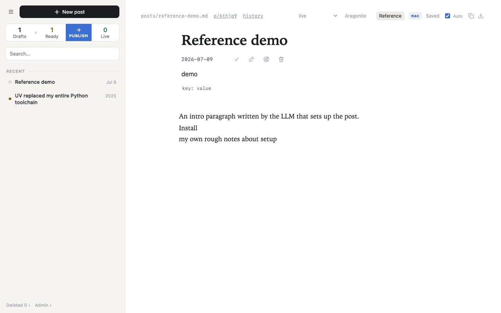
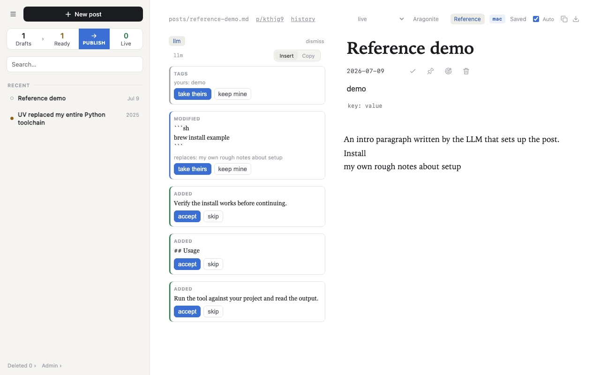
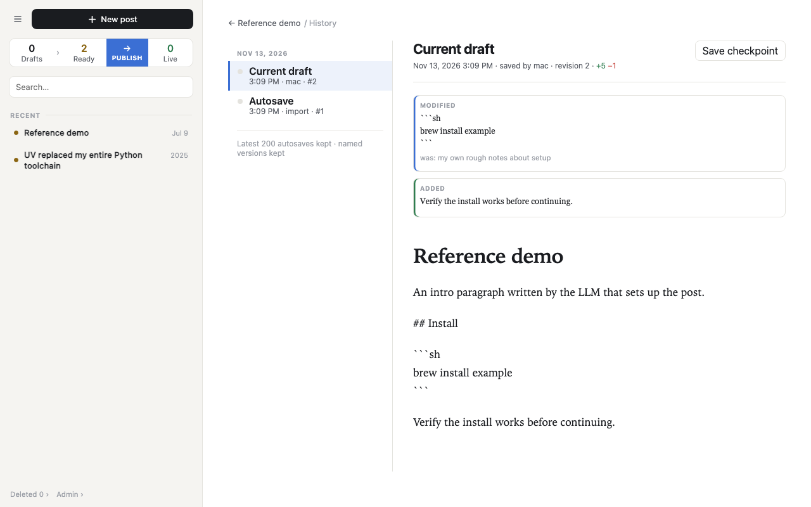
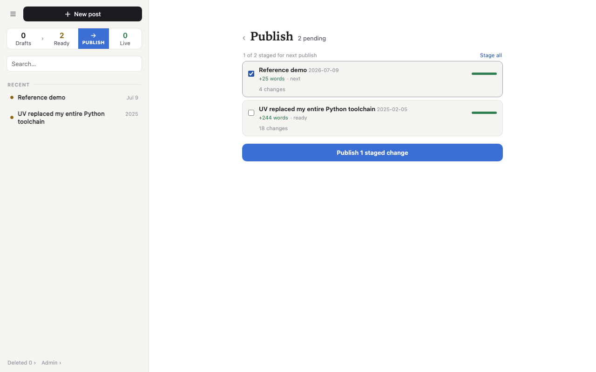

# cfcms

Write Markdown in the browser, keep drafts and revisions in SQLite, and publish staged posts to your blog.

[](https://github.com/mrgnw/cfcms/actions/workflows/ci.yml)
[](LICENSE)
[](https://github.com/mrgnw/cfcms/commits/main/)
[](https://github.com/mrgnw/cfcms/issues)
[](https://svelte.dev/docs/kit)
[](https://svelte.dev/docs/svelte)


Edit → compare versions → review history → stage for Publish. Captured with the bundled sample posts; the demo stops at review because it has no blog build or remote.

> [!NOTE]
> Developed with substantial AI assistance. Review and test changes before relying on them; AI assistance does not replace contributor review.

[Quick start](#quick-start) · [How it works](#how-it-works) · [Roadmap](ROADMAP.md) · [Contributing](CONTRIBUTING.md)

## Who it is for

One writer with a Markdown blog in a Git checkout, editing from a laptop or phone. cfcms runs as a Node app on a trusted machine; the separate blog can deploy to Cloudflare Workers. There is no authentication, so keep the editor on a trusted network or behind your own access control.

## Features

- **Write in Markdown:** Aragonite by default, with Milkdown Crepe available from the editor switch. Both edit the same post body.
- **Keep your drafts:** SQLite autosave, the latest 200 autosaves per post, retained named checkpoints, and revision restore.
- **Compare changes:** concurrent saves become versions to reconcile segment by segment; assistant-written `.llm.md` drafts appear in the reference pane.
- **Choose what ships:** drafts, ready and live stages, with per-post staging in the Publish view.
- **Build before publishing:** render the live set to `.svx`, run the blog's build gate, then commit and push its `main` branch.
- **Preserve code blocks:** fence metadata survives editing; Milkdown uses the blog's twinkleplop highlighting. Aragonite uses its own highlight.js colors.

### A closer look

| Write | Compare |
|-|-|
|  |  |
| **Revisions** | **Publish review** |
|  |  |

## How it works

```text
Browser editor <--> cfcms (SvelteKit / Node) <--> SQLite
                          |
                    staged posts
                          v
                 Git publish target
                 render .svx -> build gate
                 -> commit -> push main
                          |
                          v
               Cloudflare Workers Builds
                          |
                          v
                    Separate blog
```

SQLite holds drafts, revisions and pending versions. The Git target writes published output into the blog checkout. Workers Builds deploys that push when configured on the blog; cfcms does not run Wrangler or wait for the Cloudflare build result.

Built with SvelteKit 3, Svelte 5, TypeScript and Node's built-in SQLite. The planned Cloudflare storage target is described in the [direction](#direction) below.

## Quick start

You need Node 24 or newer and [pnpm](https://pnpm.io) 10 (the version CI uses).

```sh
git clone https://github.com/mrgnw/cfcms.git
cd cfcms
pnpm install --frozen-lockfile
```

To try it without a blog of your own, run it against a throwaway copy of the sample posts in `content/posts`. The editor writes into the folder it points at, so do not point it at this repository:

```sh
DEMO=$(mktemp -d)
mkdir -p "$DEMO/content"
cp -R content/posts "$DEMO/content/"
git -C "$DEMO" init -b main
```

```sh
BLOG_CONTENT_BASE_DIR="$DEMO" BLOG_CMS_DB="$DEMO/cms.db" HOST=127.0.0.1 PORT=5287 pnpm dev
```

Then open http://127.0.0.1:5287. Try **Reference demo**, accept a reference change, and open **history**. Enable the post's **Publish** checkmark in the editor, then select it in the **Publish** view to review staging.

The first request runs a one-time import that changes the folder it points at, which is why it must be a disposable copy. It imports Markdown posts recursively from `content/` into SQLite and deletes unpublished originals (all sample posts have no recorded publication). It commits deletions of tracked files, writes `.cms/cms-backup.db`, commits that backup and attempts to push `main`. The demo has no `origin`; that backup push failure is ignored. Git needs a configured author to make the backup commit. The demo supports editing, reference diffs, revisions and Publish review; a successful publish needs a real blog build and remote.

Stop the demo with Ctrl-C. Keep the temporary folder if you want to resume your edits.

### Connect a blog

To edit a real blog, keep its checkout next to this one at `../blog` (or set `BLOG_CONTENT_BASE_DIR`). The checkout holds posts in `content/` and gets rendered `.svx` files in `src/posts/`:

```sh
pnpm dev
```

For a production build, set the same blog and database paths at build time and runtime. Set `ORIGIN` to the editor's public URL before building: SvelteKit 3 embeds this in the server, and setting it only at runtime will not configure form posts. The build also selects the blog's highlighting assets. Run these from your cfcms checkout, after configuring `.env` from `.env.example`:

```sh
pnpm build
node --env-file=.env build/index.js
```

## Configuration

Copy `.env.example` to `.env` and change what you need. Everything has a default.

| Variable | Default | Purpose |
|-|-|-|
| `BLOG_CONTENT_BASE_DIR` | `../blog` | Blog checkout: posts in `content/`, rendered output in `src/posts/`. |
| `BLOG_CMS_DB` | `.data/cms.db` | SQLite database. |
| `BLOG_BUILD_COMMAND` | `pnpm build` | Build gate run in the blog checkout before a publish is committed. |
| `BLOG_CMS_DEPLOY_STATE_FILE` | `<blog>/.cms/deploy-state.json` | Legacy deploy state, read once on upgrade. |
| `PORT` | `5273` in dev; `3000` in the built server | Listening port. `.env.example` sets `5273` for both. |
| `HOST` | `localhost` in dev; `0.0.0.0` in the built server | Bind address. `.env.example` sets `localhost` for both. |
| `ALLOWED_HOSTS` | none | Extra hostnames the dev server accepts, comma separated (a tunnel or tailnet name). |
| `ORIGIN` | none | Editor's public URL, read at build time for the built server. Needed for form posts to pass the cross-site request forgery check. |
| `HMR_CLIENT_PORT` | none | Set to `443` when the dev server is behind an HTTPS proxy. |

The quick start overrides the host and port for an isolated local demo. For development over a tailnet, bind to a reachable interface and include the tailnet hostname in `ALLOWED_HOSTS`.

## Where the posts live

Posts are stored in SQLite, not in the blog repository. The blog repository only receives published output.

| What | Where |
|-|-|
| Working text of every post, with its revision history | `revisions` table in the database |
| Text two devices saved at the same time, waiting to be reconciled | `versions` table |
| Publish state per post (published hash, slug, commit, editing order) | `posts` table |
| Which writer and device is active | `leases` table |
| App flags such as the last backup time | `meta` table |
| Published posts | `src/posts/<slug>.svx` in the blog checkout, written by Publish |
| Staged posts | `content/*.md` in the blog checkout, written by Publish |
| Drafts written by an assistant | `content/*.llm.md`, read from disk and imported as reference |

The database is created on the first request at `BLOG_CMS_DB` (default `.data/cms.db`). On first run it imports the existing `content/*.md` files into it. `.data/` is ignored by git, so the database is never committed to this repository.

Autosave appends a revision. Each post keeps its latest 200 revisions, plus older named checkpoints, the revision that was published and any revision a pending version is based on. Other older autosaves are pruned.

To look inside, take a snapshot so the running CMS is never touched. The database runs in WAL mode, so a plain `cp` of an active database can miss recent writes; `VACUUM INTO` makes a consistent copy:

```sh
DB=.data/cms.db
SNAPSHOT=/tmp/cfcms-inspect.db
rm -f "$SNAPSHOT"
sqlite3 "$DB" "VACUUM INTO '$SNAPSHOT'"
```

```sh
sqlite3 /tmp/cfcms-inspect.db "SELECT path, published_slug, published_at FROM posts ORDER BY published_at DESC LIMIT 10"
```

```sh
sqlite3 /tmp/cfcms-inspect.db "SELECT rev, writer, saved_at, length(body) FROM revisions WHERE path = (SELECT path FROM posts LIMIT 1) ORDER BY rev DESC LIMIT 10"
```

The schema is created in `src/lib/server/db.ts`, which also adds new columns to older databases on open, so an existing database upgrades in place.

### Backups

About once a day the CMS writes a compacted copy of the database (`VACUUM INTO`) to `.cms/cms-backup.db` in the blog checkout, commits it with the message `cms: db backup`, and pushes. That copy holds every draft and revision, so keep the blog repository private, or ignore `.cms/` in it, if drafts must not become public.

To restore, stop the CMS, copy a backup over the database file, and start it again. Remove the old `-wal` and `-shm` files first, or SQLite may replay them into the restored database:

```sh
BLOG=../blog
rm -f .data/cms.db-wal .data/cms.db-shm
cp "$BLOG/.cms/cms-backup.db" .data/cms.db
```

## Checks

```sh
pnpm test
pnpm build
```

`pnpm test` runs every `src/**/*.check.ts` under `node --test`, then `pnpm check`. `scripts/check-hooks.ts` resolves `#lib` and `$app/env/private` so server modules load in plain node; server checks build a throwaway blog checkout and database under the system temp directory. CI runs the same two commands.

## Direction

**Planned:** publish to Cloudflare storage that the blog's Worker reads directly, so an article edit can go live without rebuilding the blog. Git publishing remains a supported target. The storage contract has not been designed or implemented yet.

See [ROADMAP.md](ROADMAP.md) and [epic #16](https://github.com/mrgnw/cfcms/issues/16) for the design decision and implementation tasks. User-visible changes are in [CHANGELOG.md](CHANGELOG.md).

## Contributing

Start with [CONTRIBUTING.md](CONTRIBUTING.md) and the [good first issues](https://github.com/mrgnw/cfcms/labels/good%20first%20issue). Bug fixes, tests, documentation and focused improvements to the one-writer workflow are welcome. Use the [bug and feature forms](https://github.com/mrgnw/cfcms/issues/new/choose) to describe reproducible problems or proposals.

## Code blocks

In Milkdown, code blocks are colored by twinkleplop, the same highlighter the blog uses. Aragonite uses highlight.js instead.

Crepe's code blocks are CodeMirror, which ships its own highlighter (lezer) and a One Dark theme. Lezer names tokens differently from twinkleplop, so its colors could only approximate the blog's. Instead, `src/lib/code/twinkleplop.ts` runs twinkleplop on the block's text and marks each token with its twinkleplop name (`keyword`, `string`, ...). The blog's stylesheet then colors those names directly.

Two Crepe details in `MilkdownEditor.svelte`:

- Crepe merges `featureConfigs` into its defaults with lodash `defaultsDeep`. An array is merged entry by entry, so `theme: []` still gets One Dark. The value of `EditorView.theme(...)` is not a plain object, so passing one replaces One Dark. Ours (`theme` in `twinkleplop.ts`) colours the cursor, active line and selection from the same `--twp-*` variables, so they follow light and dark mode. It also sets the blog's code font and size on `.cm-scroller` (CodeMirror's own `monospace` rule there beats `--crepe-font-code`) and hides the gutter: Crepe adds `basicSetup`, whose line numbers the blog does not show.
- The same merge appends Crepe's 143 lezer languages after ours, and those take over aliases such as `bash`. Setting `languages` in a separate `editor.config` call after `new Crepe(...)` replaces the list outright.

### Languages

The picker lists every language twinkleplop has a grammar for except C and C++, the same set the blog highlights (the list mirrors the blog's `mdsvex.config.js`). All grammars are bundled into the CMS build, so nothing loads at runtime. `text`, `lua`, `nginx` and `caddy` are listed too because posts use them, but have no grammar and stay plain, as on the site. Typing a fence such as ```` ```sh ```` followed by a space starts a code block in that language. A fence language not in the list is kept as written and shown as plain text.

### Fence meta

The blog reads extra settings after a fence's language: ```` ```py {2} title="x.py" caption="Run it" ```` (highlighted lines, title, caption). Milkdown's code block keeps only the language, so `src/lib/code/fence-meta.ts` adds a `meta` attribute that is read from the fence and written back unchanged. A block with meta shows it as a small label at its top. Meta can't be typed into a new block in the editor, and highlighted lines are not drawn here; edit the meta in the markdown. `node src/lib/code/fence-meta.check.ts` checks the round trip.

### The `$blog` alias

The `sveltekit(...)` plugin in `vite.config.ts` aliases `$blog` to `src/lib` of your blog checkout, so `shell-words.js` and `styles/code-theme.css` are imported straight from it rather than copied. Colour changes made there reach the editor the next time the CMS rebuilds. Without a checkout (or one with no `src/lib`), the alias falls back to the copies in `src/blog-defaults`, which is what CI and the demo above use. The choice is all or nothing: if the checkout has a `src/lib` at all, both files must exist there, otherwise the build fails to resolve them.

## Editors

The button left of the writer chip in a post's header switches the body editor between [Aragonite](https://github.com/voithos-labs/aragonite) (the default, MPL-2.0) and Milkdown. The choice is remembered per browser. Both editors read and write the same body, so switching mid-edit keeps your text.

The Aragonite integration is in `src/lib/components/AragoniteEditor.svelte`, with plugins in `src/lib/aragonite/plugins.ts`. Its code blocks use Aragonite's own highlight.js colors rather than twinkleplop, so they won't match the blog. A Mode menu above it switches between Aragonite's presentation modes (`live` is closest to Milkdown).

## Publishing

The CMS exposes `POST /api/publish` and a Publish view in the UI. Pending changes are staged per post; only staged posts go out.

Publish renders the full live set to `src/posts/<slug>.svx` in the blog checkout (the CMS owns that directory: unstaged posts keep their published revision, unpublished posts are removed), writes the staged posts to `content/*.md`, runs the blog build as a gate, commits, and pushes `main`. Cloudflare Workers Builds deploys the push. The CMS never runs `wrangler`.

The site text is tracked by revision: `published_hash` names the revision each `.svx` was rendered from. A `.svx` edited outside the CMS is picked up when the Publish view loads or a publish starts: if the draft did not move, the site text becomes the new head; if both moved, the post shows as blocked with a `site` version (the text as it is on the site) to resolve per segment.

The blog build command defaults to `pnpm build` and runs in the blog checkout; set `BLOG_BUILD_COMMAND` to change it. To trigger a publish from a script:

```sh
curl -X POST http://localhost:5273/api/publish
```

## License

[MIT](LICENSE). That covers cfcms's own code. Dependencies keep their own licenses: [Aragonite](https://github.com/voithos-labs/aragonite) and its plugin packages are MPL-2.0, Milkdown is MIT, and the bundled IBM Plex Mono font is OFL-1.1.

